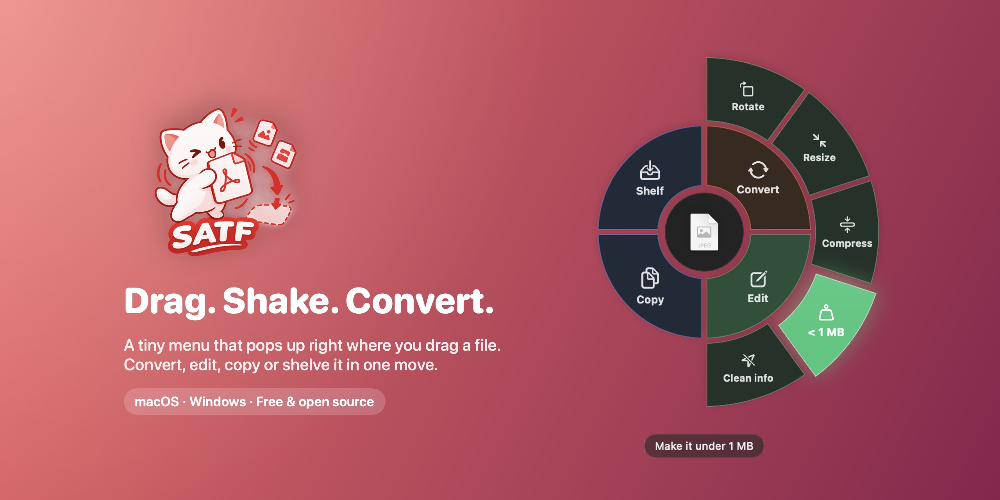
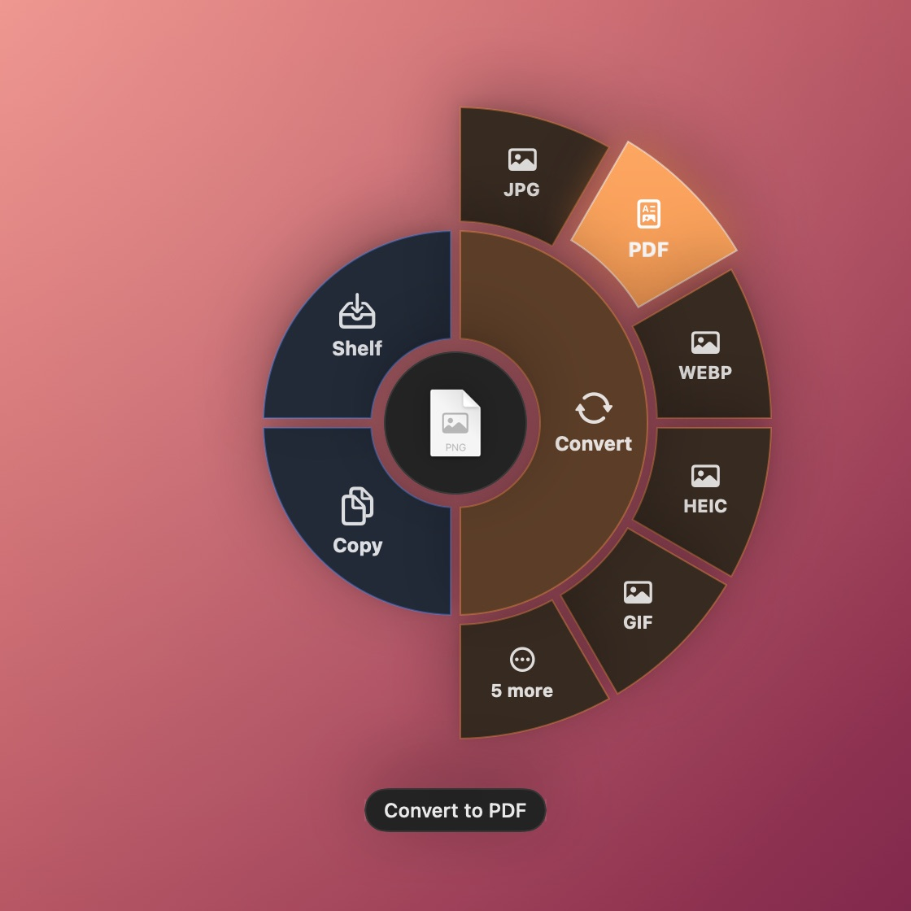
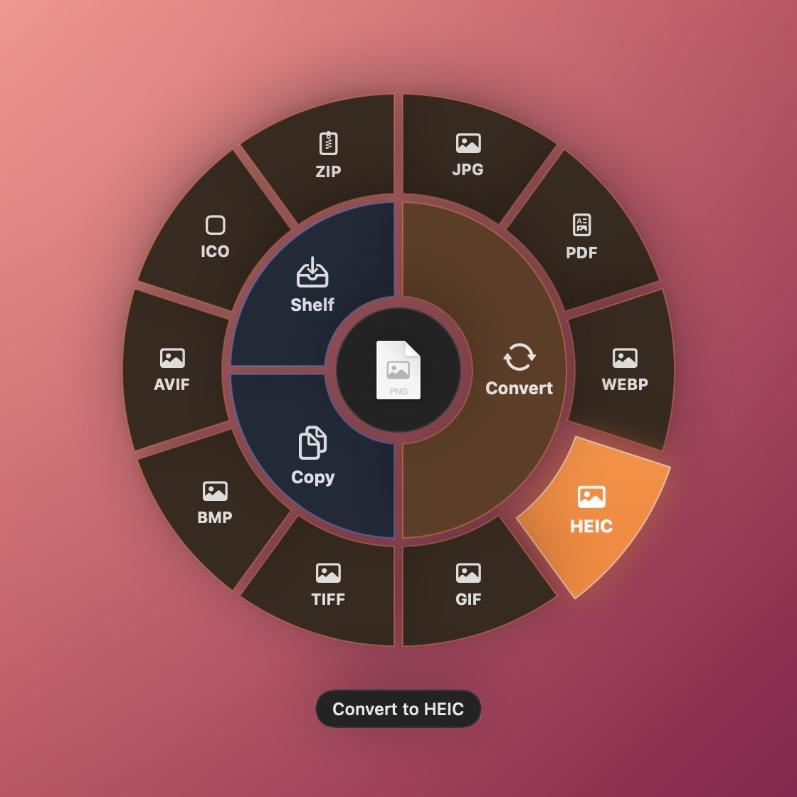
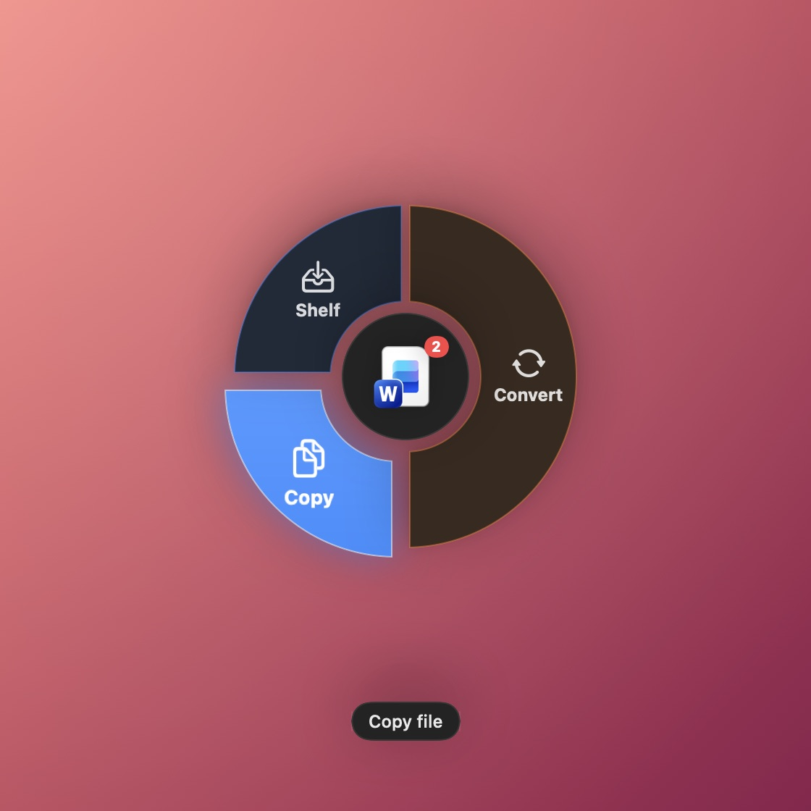
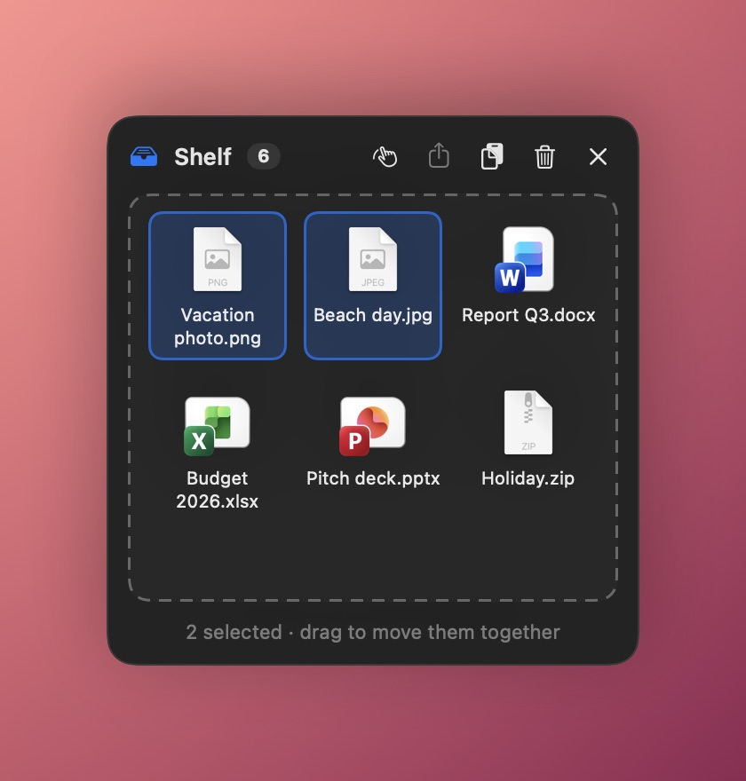
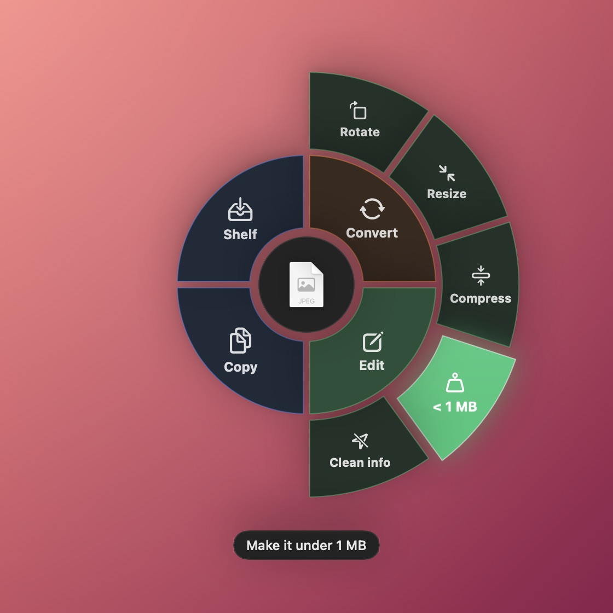
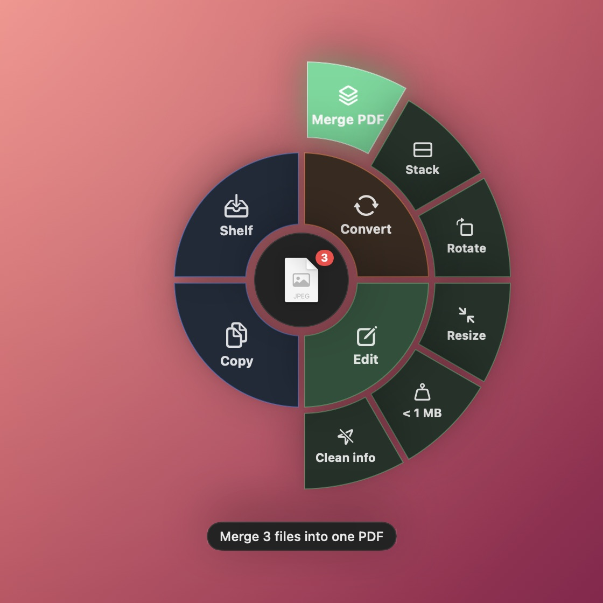
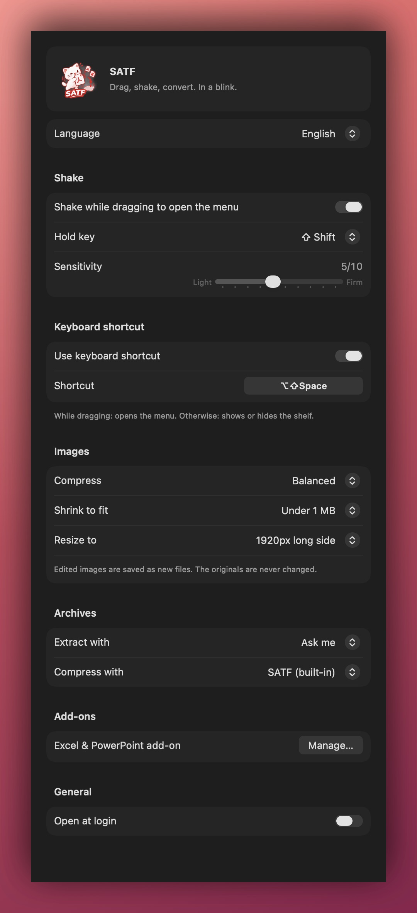

<p align="center">
  
</p>

<h1 align="center">SATF</h1>

<p align="center">
  <b>Drag a file, give it a little shake, and convert it in a blink.</b><br>
  A tiny radial menu for macOS and Windows that pops up right where you drag.
</p>

<p align="center">
  <a href="https://github.com/tran-minh-khoi/SATF/releases/latest"></a>
  <a href="https://github.com/tran-minh-khoi/SATF/releases/latest"></a>
  <a href="LICENSE"></a>
</p>

<p align="center">
  <a href="https://mktechvn.com/en/satf"><b>Website</b></a> ·
  <a href="#download">Download</a> ·
  <a href="#how-it-works">How it works</a> ·
  <a href="#what-it-converts">What it converts</a> ·
  <a href="#build-from-source">Build</a> ·
  <a href="README.vi.md">Tiếng Việt</a>
</p>

---

## Why SATF?

Converting a file usually means opening an app, finding *Export*, picking a format and a folder. With SATF you just keep dragging:

- **Shake** the file you're dragging (or press <kbd>⌥ ⇧ Space</kbd> / <kbd>Alt + Shift + Space</kbd>).
- A menu appears **under your cursor**.
- **Drop** the file on a format. The new file appears next to the original. That's it.

No uploads, no accounts, no ads. Everything happens on your computer.

## Features

- 🎯 **Radial menu right at your cursor:** Convert and Edit on the right, Copy and Shelf on the left.
- ✏️ **Quick image edits:** rotate, resize, compress, squeeze under 1 MB, remove location & camera info, or stack several images into one tall image. Rotate PDFs too.
- 🔄 **Convert images, PDFs, documents, video and audio:** the most-used formats come first, the rest are one hover away.
- 📚 **Several files at once:** merge them into **one PDF** (PDFs, Word, Excel, PowerPoint, images, text, in the order you picked them), or compress them into **one ZIP**. A multi-page PDF can also be **split** into one PDF per page.
- 📦 **Extract archives:** zip, rar, 7z, tar, gz, bz2, xz. Works with The Unarchiver, Keka, 7-Zip, WinRAR and others if you prefer them.
- 🗂️ **Shelf:** a floating tray to collect files from different places. Select several (Ctrl/⌘-click, Ctrl+A/⌘A) and drag them out together, copy them, or share them.
- 🪶 **Lightweight by default:** heavy add-ons (LibreOffice, FFmpeg) download only when you need them, and you can remove them anytime.
- 🔔 **Clear feedback:** a progress note for longer jobs, then *"Done · saved in Downloads"*. Click it to show the file.
- 🌏 **English and Tiếng Việt**, switchable in Settings.
- 🧹 **Clean uninstall** that removes everything SATF created.

## Download

| Platform | Download | Requirements |
|---|---|---|
| **macOS** | [SATF-1.2.0.dmg](https://github.com/tran-minh-khoi/SATF/releases/latest) | macOS 13 Ventura or later · Apple Silicon & Intel |
| **Windows** | [SATF-Setup-1.2.0.exe](https://github.com/tran-minh-khoi/SATF/releases/latest) | Windows 10 (2004) or later · 64-bit |

All versions are on the [Releases page](https://github.com/tran-minh-khoi/SATF/releases).

### Installing on macOS

1. Open the DMG and drag **SATF** into **Applications**.
2. Open SATF. It's signed and notarized by Apple, so it opens right away.
3. Look for the SATF icon in the menu bar. That's where Settings, Shelf and Add-ons live.

### Installing on Windows

1. Run **SATF-Setup**. Pick your language and any add-ons you want now (you can skip them).
2. If Windows shows *"Windows protected your PC"*, click **More info → Run anyway**.
3. SATF starts with Windows and lives in the system tray (bottom-right corner).

> **Why the Windows warning?** The macOS app is signed and notarized by Apple. The Windows app isn't code-signed yet, so SmartScreen asks once. The source code is right here if you'd like to check it or build it yourself.

## How it works

<table>
  <tr>
    <td width="50%"></td>
    <td width="50%"></td>
  </tr>
  <tr>
    <td align="center"><b>Convert:</b> drop the file on a format.</td>
    <td align="center"><b>More formats:</b> hover <i>More</i> to see them all.</td>
  </tr>
  <tr>
    <td width="50%"></td>
    <td width="50%"></td>
  </tr>
  <tr>
    <td align="center"><b>Copy</b> (bottom) or <b>Shelf</b> (top).</td>
    <td align="center"><b>Shelf:</b> select several files and drag them out together.</td>
  </tr>
  <tr>
    <td width="50%"></td>
    <td width="50%"></td>
  </tr>
  <tr>
    <td align="center"><b>Edit:</b> rotate, resize, compress, squeeze under 1 MB, clean info.</td>
    <td align="center"><b>Several files:</b> merge into one PDF or stack into one image.</td>
  </tr>
</table>

1. **Start dragging** any file or several files.
2. **Shake** it left and right while holding <kbd>Shift</kbd>, or press the shortcut.
3. **Drop** it on:
   - **Convert →** (top right) a format. More than six choices? Hover **More** to open the full circle.
   - **Edit →** (bottom right) an edit: rotate, resize, compress, under 1 MB, clean info, merge PDF, stack. The original is never changed.
   - **Copy** puts the file on the clipboard.
   - **Shelf** keeps it in a floating tray for later.
4. Changed your mind? Press <kbd>Esc</kbd>, click outside, or just drop the file somewhere else.

Not dragging anything? The shortcut opens the Shelf instead.

## What it converts

New files are saved next to the original, and the original is never changed.

| You drag… | macOS | Windows |
|---|---|---|
| **Images:** PNG, JPG, HEIC, WebP, GIF, TIFF, BMP, SVG… | JPG, PNG, PDF, WebP, HEIC, GIF, TIFF, BMP, AVIF, ICO | JPG, PNG, PDF, WebP, GIF, TIFF, BMP |
| **PDF** | JPG, PNG (one per page), TXT, Split (one PDF per page) | JPG, PNG (one per page), DOCX ¹, Split (one PDF per page) |
| **Word:** DOCX, DOC, ODT, RTF | PDF, DOCX, TXT, RTF, HTML, ODT | PDF, DOCX, TXT, RTF, HTML, ODT ¹ |
| **Excel:** XLSX, XLS, ODS | PDF, CSV ¹ | PDF, XLSX, CSV ¹ |
| **PowerPoint:** PPTX, PPT, ODP | PDF, PNG, JPG ¹ | PDF, PNG, JPG, PPTX ¹ |
| **Text:** TXT, MD, HTML | PDF, DOCX, TXT, RTF, HTML, ODT | TXT, MD, HTML, PDF ¹, DOCX ¹ |
| **Video:** MP4, MOV, MKV… | MP4, MOV, M4A | MP4, MP3, M4A, WAV ² |
| **Audio:** MP3, WAV, M4A… | M4A, WAV, AIFF | MP3, M4A, WAV ² |
| **Archives:** zip, rar, 7z, tar, gz, bz2, xz | Extract | Extract |
| **Anything else, including folders** | ZIP | ZIP |
| **Several files** (PDF, Word, Excel, PowerPoint, images, text) | Merge into one PDF ³ | Merge into one PDF ¹ ³ |
| **Several files of any kind** | One ZIP with all of them | One ZIP with all of them |

¹ Uses Microsoft Office if you have it; otherwise the **Office add-on**.
² Needs the **Video & music add-on**.
³ Pages follow the order you picked the files. Office files need the same apps or add-on as converting them to PDF.

## Add-ons

SATF stays small. Bigger tools download only when they're needed:

| Add-on | Unlocks | Download size |
|---|---|---|
| **Office** (LibreOffice) | Excel & PowerPoint on Mac; Word, Excel & PowerPoint on Windows | ~300–350 MB |
| **Video & music** (FFmpeg, Windows only) | MP4, MP3, M4A, WAV | ~115 MB |

- **During setup:** the Windows installer lets you tick add-ons. On Mac, SATF asks the first time you open it, and only if you don't already have Office or Numbers / Keynote.
- **When you need one:** SATF asks *"One more step"*, downloads it, then converts your file right away.
- **Free up space:** menu → **Add-ons…** shows how much each one uses, with a **Remove** button. If you need it again, SATF will ask.

Already have Microsoft Office? SATF uses it and doesn't ask for anything.

## Archives

Drag a zip, rar, 7z, tar, gz, bz2 or xz file and choose **Extract**. Files appear in a folder next to the archive. If the archive holds just one folder, you get that folder directly, without an extra nested one.

Have another archive app? SATF supports **The Unarchiver, Keka, BetterZip, WinZip** (Mac) and **7-Zip, WinRAR, Bandizip** (Windows). The first time, SATF asks which one to use: **Just once** or **Always**. Change it later in **Settings → Archives**, separately for extracting and for making ZIPs.

## Settings

<p align="center"></p>

- **Language:** English or Tiếng Việt.
- **Shake:** turn it on or off, choose a key to hold (none, Shift, Option/Alt, Control, Command) and how firm the shake should be (a 1–10 slider).
- **Images:** compress level, the "under … MB" target (200 KB–5 MB) and the resize size (1080–3840px).
- **Keyboard shortcut:** click and press a new combination.
- **Archives:** which app extracts and which app makes ZIPs.
- **Add-ons:** see, download or remove them.
- **Open at login / Start with Windows.**

## Privacy

- Files never leave your computer. SATF converts everything locally.
- No accounts, no analytics, no tracking.
- SATF goes online only when **you** choose to download an add-on, and only to the official project sites (libreoffice.org, gyan.dev).

## Uninstall

- **From the app:** menu → **Uninstall SATF…** removes the app, settings and add-ons.
- **Windows:** you can also use *Settings → Apps* or *Control Panel → Programs*.
- **macOS:** dragging SATF to the Trash leaves downloaded add-ons behind in `~/Library/Application Support/SATF`. Use **Uninstall SATF…** to remove everything.

## Feedback

Found a bug or have an idea? Use **Report a Bug…** or **Suggest a Feature…** in the SATF menu (it opens an email), or [open an issue](https://github.com/tran-minh-khoi/SATF/issues/new/choose).

## Build from source

Both apps build on a Mac.

**macOS app** (needs the Xcode Command Line Tools: `xcode-select --install`):

```bash
./build.sh
```

→ `build/SATF.app` and `build/SATF-<version>.dmg`

**Windows app** (needs the [.NET 10 SDK](https://dotnet.microsoft.com/download) and NSIS: `brew install makensis`):

```bash
./build-win.sh
```

→ `build/windows/SATF-Setup-<version>.exe` (installer) and `build/windows/SATF.exe` (portable)

**Screenshots** for this README come straight from the SwiftUI code:

```bash
./scripts/screenshots.sh
```

The version number lives in [`VERSION`](VERSION). All icons are generated from [`assets/logo.png`](assets/logo.png).

<details>
<summary><b>Project structure</b></summary>

```
├── Sources/                  macOS app (Swift · AppKit + SwiftUI)
│   ├── AppDelegate.swift       Menu bar icon, menu, uninstall, feedback
│   ├── RadialMenu.swift        The radial menu
│   ├── Converter.swift         All conversions
│   ├── Archivers.swift         Third-party archive apps
│   ├── AddOns.swift            Add-on download / remove
│   ├── Shelf.swift             Floating shelf
│   ├── Settings*.swift         Settings & language
│   ├── ShakeDetector.swift     Shake gesture
│   └── HotKeyManager.swift     Global shortcuts (incl. Esc)
├── Windows/                  Windows app (C# · WPF)
│   ├── RadialMenuWindow.cs     The radial menu
│   ├── Converter.cs            All conversions
│   ├── Archivers.cs            7-Zip, WinRAR, Bandizip
│   ├── AddOns.cs               Add-on download / remove
│   ├── SettingsWindow.cs       Settings
│   └── installer.nsi           Windows installer (NSIS)
├── assets/logo.png           Logo, source of every app icon
├── docs/images/              README screenshots
├── scripts/screenshots.sh    Regenerates the screenshots
├── build.sh · build-win.sh   Build scripts
└── VERSION                   Version for both apps
```

</details>

## Contributing

Pull requests, translations and ideas are welcome. Please read [CONTRIBUTING.md](CONTRIBUTING.md) first.

## Support SATF

SATF is free and open source. If it saves you time, you can buy me a coffee. Scan the VietQR code below with any Vietnamese banking app, or open **Support SATF…** from the menu bar / tray menu. A ⭐ on GitHub helps a lot too.

<p align="center"></p>

## License

SATF is released under the [MIT License](LICENSE). Bundled and optional third-party components keep their own licenses; see [THIRD_PARTY_NOTICES.md](THIRD_PARTY_NOTICES.md).

## Author

Made with 🐾 by **Tran Minh Khoi**

- SATF website: [mktechvn.com/satf](https://mktechvn.com/en/satf)
- Personal site: [tranminhkhoi.dev](https://tranminhkhoi.dev)
- Email: [contact@tranminhkhoi.dev](mailto:contact@tranminhkhoi.dev)

If SATF saves you a few clicks, a ⭐ on GitHub means a lot!
